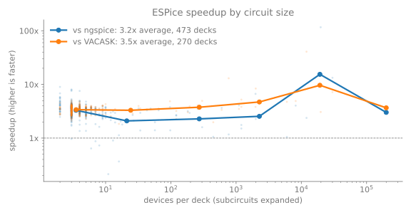

# ESPice

A SPICE circuit simulator written in Zig. Every device model is Verilog-A, compiled at build time by
[VerA](https://github.com/OmarSiwy/VerA), and one device kernel builds for the CPU, CUDA and HIP
through [Gompute](https://github.com/OmarSiwy/Gompute).

```sh
espice deck.sp                                   # ngspice, HSPICE or Spectre deck, detected
espice -r out.raw deck.sp                        # also write waveforms
espice --format=touchstone -r out.s2p deck.sp
espice --backend cuda sweep.sp                   # sweep points as GPU lanes
```

Docs: <https://omarsiwy.github.io/ESPice/> · Changes: [CHANGELOGS.md](CHANGELOGS.md) ·
Worked example vs HSPICE: [EXAMPLES.md](EXAMPLES.md)

## Install

```sh
nix run github:OmarSiwy/ESPice -- deck.sp
nix profile install github:OmarSiwy/ESPice      # .#espice-cuda adds CUDA
```

From source (Zig 0.18.0-dev.349, provided by the devshell; VerA and Gompute are pinned in
`build.zig.zon`):

```sh
nix develop            # .#ci for CPU only
zig build              # zig-out/bin/espice; -Dgpu=false skips the GPU kernels
```

## What it does

- **Analyses:** `op dc dcmatch sens tf temp`, `ac noise sp stb pz disto`,
  `tran tran_noise four envelope matex`, `pss pac pnoise pxf qpss hb`, `mc`.
- **Devices:** BSIM1–4, BSIM-SOI, BSIM-CMG, PSP, HiSIM2/HV, MOS 1/2/3/6/9, VDMOS, Gummel-Poon,
  VBIC, HICUM, JFET/MESFET/HFET, passives, controlled and behavioural sources, switches,
  transmission lines.
- **Your own models:** `.hdl "model.va"` plus an `N` card compiles a Verilog-A module at run time
  (needs that Zig on `PATH` or in `$ZIG`; cached under `~/.cache/espice/hdl`). OSDI is not loaded.
- **Output:** binary/ASCII raw, CSV, Touchstone, PSF, FSDB, SST2, CITIfile, print.
- **Parallel by default:** analyses form a DAG and run on every core (`--jobs`). `--plan` prints the
  DAG without solving.
- **Sweep throughput:** when nothing reads the waveforms, `.meas` cards stream, each transient stops
  once its measures resolve, and OPs warm-start from the nominal one. The printed values match a
  full run. `--full-waveforms` turns this off.
- **Lanes:** `--backend cuda` (or `hip`) runs sweep points as GPU lanes; `auto` picks the GPU only on
  FP64-class cards. CPU lanes (`--lanes`) are off by default.
- **Library:** `include/espice.h` is the C API, including the points API for optimizer loops
  (append points, read measures and tangents).

`espice --help` lists every flag. Exit code is 1 if any deck fails, 2 on a usage error.

## Performance

<!-- bench:start -->


| Compared with | Decks both ran | ESPice faster | Median speedup | Agree / differ |
|---|---:|---:|---:|---:|
| ngspice | 473 | 466 | 3.3x | 424 / 13 |
| VACASK | 270 | 270 | 3.5x | 234 / 17 |

Median of 3 runs after a warm-up, process startup included, CPU backend, 32 x Intel(R) Core(TM) i9-14900HX, commit `3a57edf3`, 2026-07-29 (local run; `.github/workflows/bench.yml` regenerates this on each release).
<!-- bench:end -->

Full report and per-analysis charts: [docs/performance](docs/performance/index.md).

## Tests

`zig build test` runs the unit suites and then the fixture corpus: about 920 decks in
`tests/conformance/tests/netlist/`, each scored against its `.expected.json` (oracles from ngspice and
VACASK). The decks live in the
[VAMS Conformance Suite](https://github.com/OmarSiwy/VAMS-Conformance-Suite), a submodule
(`git submodule update --init tests/conformance`; the flake reads the same commit as its `conformance`
input). Add or fix a deck there, then move the submodule and `nix flake update conformance` together. Per-area steps: `test-core`, `test-solver`, `test-device`, `test-frontend`,
`test-analysis`, `test-output`, `test-espice`, `test-c-api`. Benchmarks:
`nix develop .#benchmarking -c zig build bench`.

## License

Apache-2.0 ([LICENSE](LICENSE)). Models in `models/` keep their own licences
([models/LICENSES.md](models/LICENSES.md)); `models/bsim4va.va` (BSIM4, `LEVEL=14`/`54`) is
CC-BY-NC 4.0, so commercial users must replace it.
